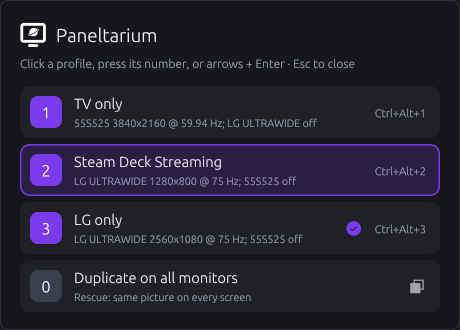
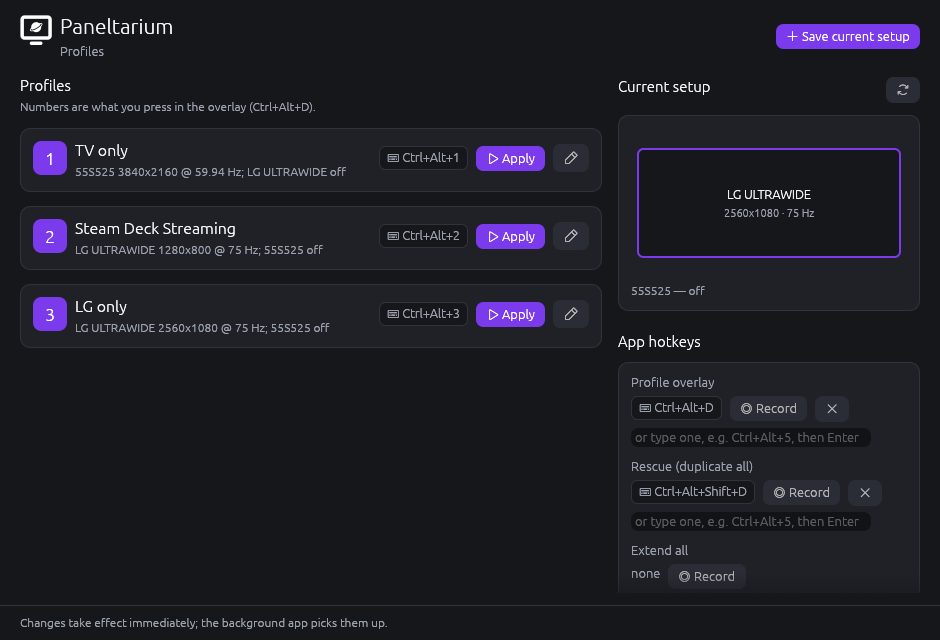

<p align="center"></p>

# Paneltarium

**Switch between your monitor setups with one key, or from your game
controller.** A lightweight, fast tray app for Windows and Linux, written
in Rust.

Paneltarium doesn't replace Windows' display settings. You still arrange
your monitors the usual way, in **Settings → System → Display** (or your
graphics card's control panel). Paneltarium **saves each arrangement as a
profile** and lets you switch between them instantly: desk, TV only,
everything on, presentation, and so on.

A profile remembers which monitors are on, and each one's resolution,
refresh rate, position, rotation and which one is the main display.

## Switch from the couch 🎮

Gaming on the TV, streaming to a handheld, back to the desk: you don't
need a keyboard for any of it.

- **Hold A + LB + RB + LT + RT** on your controller to bring up your
  profiles, **D-pad** to pick one, **let go** to switch. Press **B** to
  cancel.
- **Works while you play.** Paneltarium listens in the background, and the
  profile list doesn't take focus away from your game. It shows over
  borderless and windowed games; a game in exclusive fullscreen may hide it.
- **Xbox, PlayStation, Switch and Steam controllers.** Xbox and other
  XInput pads, DualShock 4 and DualSense, Switch Pro, Joy-Cons and Switch 2
  controllers work directly, with no extra drivers or tools, wired or
  Bluetooth. So do many other pads, through
  [SDL](https://libsdl.org)'s controller support.
- **Steam Controller too.** While Steam is running, Paneltarium reads the
  Steam Controller directly, even on the desktop, where Steam turns its
  buttons into keys and mouse clicks. (Those still happen too; a
  combination of back buttons like **L4 + R4** avoids stray clicks.)
- **Your combination, your call.** Record any button combination, back
  paddles included, in the profile manager, or turn controller support off
  with one switch. Your combination is kept for when you turn it back on.
- **Check what it sees:** `paneltarium gamepads --watch` lists your
  controllers and shows each button press live.

## Get started

Install it with `Paneltarium-<version>-setup.exe` from the GitHub
Releases page (no admin rights needed; tick *Start Paneltarium when I sign
in*). Then:

1. **Set up your monitors** in Windows' display settings the way you want
   them.
2. **Save it as a profile:** right-click the Paneltarium tray icon →
   **Open profile manager…** → **Save current setup**, and give it a name.
   Repeat steps 1–2 for each setup you use.
3. **Switch:** press **Ctrl+Alt+D**, keep holding Ctrl+Alt, and press the
   profile's number (or click it). On a controller, hold
   **A + LB + RB + LT + RT** and use the D-pad.

That's it. Lost a screen and can't see anything? **Ctrl+Alt+Shift+D** shows
the same picture on every monitor.

### On Linux

Download `Paneltarium-<version>-linux-x86_64.tar.gz` from the Releases page,
unpack it and run `./install.sh` (installs for you only, into `~/.local`;
`./install.sh --uninstall` removes it). Then start **Paneltarium** from your
app menu. It works on:

| Desktop | Needs |
|---|---|
| GNOME (Fedora, Ubuntu, …), Wayland or X11 | nothing extra; for the tray icon, the *AppIndicator and KStatusNotifierItem Support* extension (preinstalled on Ubuntu) |
| KDE Plasma (Wayland) | `kscreen-doctor` (comes with Plasma) |
| Sway, Hyprland, river, labwc, Wayfire… | `wlr-randr` |
| X11 sessions: Xfce, MATE, Cinnamon, i3, Plasma on X11… | `xrandr` |

Plus GTK 3 and `libayatana-appindicator3` for the tray icon (on most
desktops already there). Arrange your monitors in your desktop's display
settings, then save profiles as above.

On Wayland:

- **Approve the shortcuts.** The first time Paneltarium starts, your desktop
  asks you to allow its keyboard shortcuts; you can change them later in its
  keyboard settings. This needs GNOME 48+, KDE Plasma 5.27+ or Hyprland.
- **The profile list stays open after you let go.** Wayland doesn't let
  apps see the keyboard, so pick with Ctrl+Alt+number (or click), or close
  it with Ctrl+Alt+Esc / Ctrl+Alt+D.
- **On GNOME, a profile lasts until monitors are plugged in or out.** Then
  GNOME goes back to its own saved arrangement; press the profile's hotkey
  again. (Paneltarium switches without GNOME's "Keep these settings?"
  countdown, which would undo a switch made from the couch.)

## Everyday use

| Press | To |
|---|---|
| **Ctrl+Alt+D** | open the profile list: press a number, use the arrows + Enter, or click. Keep holding Ctrl+Alt (you can let go of D); let go to cancel. Prefer not to hold anything? Pick *stays open* in the profile manager. |
| a profile's own hotkey (e.g. Ctrl+Alt+1) | switch straight to that profile |
| **Ctrl+Alt+Shift+D** | rescue: same picture on every monitor |
| controller **A + LB + RB + LT + RT** (hold) | open the profile list from the couch: D-pad to choose, let go to switch, B to cancel |



The **profile manager** (tray → *Open profile manager…*) is where you:

- save, rename, update and delete profiles
- choose their numbers and record hotkeys
- change the app's hotkeys and the controller buttons, or switch
  controllers off
- choose whether the profile list needs Ctrl+Alt held or stays open on its
  own
- start Paneltarium with Windows, and choose what happens at sign-in:
  leave the monitors as they are, load the last profile you used, or load a
  specific one
- pick the accent colour

Changes take effect immediately. Your profiles are saved as small files in
`%APPDATA%\Paneltarium\profiles\`, so you can back them up or copy them to
another PC.



## Light by design

- **Native Rust, no runtime.** No .NET, Electron, Java or browser engine,
  just three small self-contained programs.
- **Idle means idle.** The tray app sleeps until you press a hotkey or click
  the tray. The only background check is for game controllers: 4× a second,
  rising to 120× a second only while one is plugged in. You can switch it
  off entirely.
- **Small footprint.** The pop-up list is drawn by a tiny built-in renderer
  and only exists while it's on screen. The profile manager is a separate
  program that only runs while it's open.
- **Instant switching.** Every monitor changes in one step through the same
  Windows display API the Settings app uses, after Windows has checked the
  change will work.
- **Plain files.** Profiles and settings are small text files you can read,
  back up or sync. The only registry entry is the optional "Start with
  Windows" one.

Measured on Linux with the release build, the tray app idles at about 0.2 %
of one CPU core with about 19 MB of private memory, most of it Linux's tray
library, which Windows doesn't need.

> **Status:** everything above works. Installers are built automatically
> for each release (see *Releases* below); until the first one is
> published, build from source and run `paneltarium-app.exe`. Renamed from
> *Monitor Pilot*: existing profiles and settings carry over on first run.

---

## Advanced

### Not saved in profiles

Display scaling (%), HDR and colour profiles are left to Windows, which
remembers them per monitor. If a monitor in a profile isn't plugged in, the
others are still switched on and slid together so there are no gaps.

### Command line

Everything the app does is also available from `paneltarium.exe`:

```powershell
paneltarium monitors                         # what's connected right now
paneltarium save "Desk" --hotkey Ctrl+Alt+1  # save the current setup
paneltarium profiles
paneltarium apply "TV only" --dry-run        # ask Windows first, change nothing
paneltarium apply "TV only"
paneltarium duplicate                        # same picture on every monitor
paneltarium extend
paneltarium settings --overlay-hotkey Ctrl+Alt+D --duplicate-hotkey Ctrl+Alt+Shift+D
paneltarium settings --overlay-mode toggle   # list stays open without holding keys (or: hold)
paneltarium settings --gamepad off           # or --gamepad-overlay A+LB+RB+LT+RT
paneltarium settings --startup last          # at sign-in: none | last | a profile name
paneltarium settings --accent "#7C3AED"      # accent colour (or "default")
paneltarium autostart on                     # start the tray app when you sign in
paneltarium paths                            # where profiles live
```

Add `--json` for machine-readable output, or `--debug` to print what's sent
to Windows.

### At sign-in

With "Start with Windows" on, the sign-in choice (`--startup`) is only
applied when the app was started by signing in. It waits up to 30 s for the
profile's monitors to appear (TVs and docks can be slow) and does nothing if
that setup is already on screen.

### Files

Everything lives in `%APPDATA%\Paneltarium`
(`C:\Users\<you>\AppData\Roaming\Paneltarium`); `paneltarium paths` prints
the exact folders.

- Profiles: `profiles\*.toml`, one per profile.
- Settings: `settings.toml`.
- Logs: `logs\`.

A profile file that can't be read is skipped and reported in the tray and
manager; the others keep working.

### Build from source

You need Rust, a C/C++ compiler and CMake; [docs/DEVELOPMENT.md](docs/DEVELOPMENT.md)
has copy-paste setup commands for Windows and Linux, and how to run and
test everything.

```powershell
cargo build --release                # all three programs, in target\release
cargo run -p paneltarium-app         # dev build with a console showing the log
```

### Releases

Pushing a version tag builds and publishes a release (`.github/workflows/release.yml`):

```powershell
# 1. set `version` in Cargo.toml (e.g. 0.2.0) and commit it
git tag v0.2.0
git push origin v0.2.0
```

GitHub Actions then runs the tests, builds the three programs, and attaches
these to a new GitHub Release:

- `Paneltarium-0.2.0-setup.exe`: per-user installer that offers *Start
  Paneltarium when I sign in*, adds Start-menu shortcuts and closes a running
  copy when upgrading.
- `Paneltarium-0.2.0-portable.zip`: the programs on their own.
- `Paneltarium-0.2.0-linux-x86_64.tar.gz`: the Linux programs, menu entries
  and `install.sh`.
- `SHA256SUMS.txt`: checksums for all of them.

Uninstalling keeps your profiles. Every push and pull request also runs
`.github/workflows/ci.yml` (formatting, lints and tests on Windows and
Linux). To build the installer locally, install [Inno Setup 6](https://jrsoftware.org/isinfo.php), then:

```powershell
cargo build --release
& "${env:ProgramFiles(x86)}\Inno Setup 6\ISCC.exe" /DAppVersion=0.1.0 installer\paneltarium.iss   # → target\installer\
```

### Project layout

```
crates/
  pt-core/              OS-neutral: model, profiles, hotkeys, matching, theme, traits, mock
  pt-platform/          OS-specific code: src/windows/ and src/linux/ (GNOME, KDE, wlroots, X11)
  pt-gamepad/           reads game controllers on a background thread (SDL 3)
  pt-brand/             the app icon (planet in a display), drawn at any size
  paneltarium/          command line
  paneltarium-app/      tray app: hotkeys, profile overlay, tray icon
  paneltarium-manager/  profile manager window (egui)
assets/                 paneltarium.ico (embedded in the .exe files) and a 256 px PNG
installer/              Inno Setup script for Windows; linux/ archive, install.sh and menu entries
.github/workflows/      ci.yml (every push) and release.yml (version tags)
docs/
  ARCHITECTURE.md       how the pieces fit, key decisions
  ROADMAP.md            testable steps, with what to check at each one
  DEVELOPMENT.md        setting up, building, running and testing
```

### Tests

```powershell
cargo test            # 223 tests on Linux (169 on Windows), no real monitors needed
cargo clippy --all-targets
```

The tests use a fake monitor backend that rejects the same layouts Windows
would. You can use it by hand too: set `$env:PANELTARIUM_MOCK_LAYOUT` to a
TOML layout file and `$env:PANELTARIUM_HOME` to a scratch folder.

## License

Paneltarium is open source under the [MIT License](LICENSE).

It builds on other open-source work, including the
[Phosphor Icons](https://phosphoricons.com) (MIT), the Ubuntu font bundled
with [egui](https://github.com/emilk/egui) (Ubuntu Font Licence), and the Rust
crates listed in `Cargo.lock`, each under its own licence.
