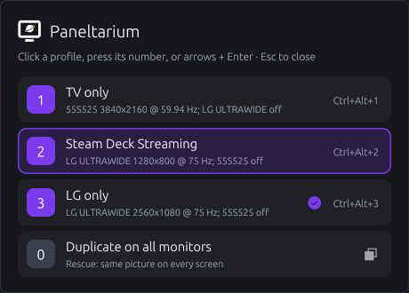
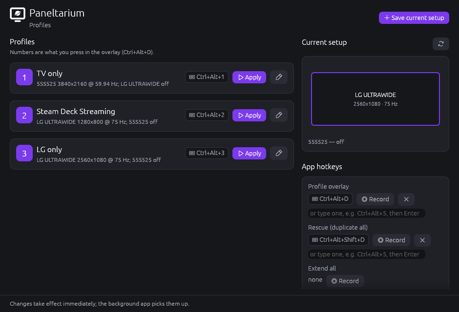

# Roadmap

Each step ends in something you can run and check before moving on.

| # | Step | Status |
|---|------|--------|
| 1 | Workspace + OS-neutral core | ✅ done, 47 unit tests + 33 arrangement tests |
| 2 | Windows: read monitor state | ✅ verified on real hardware |
| 3 | Windows: apply profiles, duplicate, extend | ✅ verified on real hardware |
| 4 | CLI | ✅ done, 10 end-to-end tests |
| 5 | Background app + global hotkeys | ✅ verified on real hardware |
| 6 | Profile overlay: keyboard, mouse | ✅ written, 20 tests (mouse verified in a test run) — **verify on your PC** |
| 6b | Overlay from a game controller | ✅ written, tested without hardware — **verify with your controller** |
| 7 | System tray icon | ✅ verified on real hardware |
| 8 | Profile manager window | ✅ written, 9 tests — **verify on your PC** |
| 8b | Manager polish: bring an open window to front | (window icon done in 9b) |
| 9 | Start at sign-in + sign-in profile | ✅ written, tested on Linux/mock — **verify on your PC** |
| 9b | Rename to Paneltarium, new icon, review of monitor edge cases | ✅ written — **verify on your PC** |
| 9c | Controllers via SDL 3 (PlayStation, Switch, Steam Controller) | ✅ written — **verify with your controllers** |
| 10 | CLI ↔ running app (IPC) | ⏭ next (or 11 first) |
| 11 | Installer + release CI | ✅ written, linted — **verify with your first tag** |
| 12 | Linux backend (future) | |
| 13 | Accent colour from the OS (Windows, GNOME, KDE, …) | planned |
| 14 | HDR in profiles: save, show and apply it per monitor | planned |

---

## 1. Workspace + core ✅

`crates/pt-core`: model, hotkey parsing, profile store, settings, the
profile→monitor matching ("plan"), the `DisplayBackend` trait, a mock backend
and the `MonitorService` facade.

**Check:** `cargo test -p pt-core`

## 2. Windows: read monitor state ✅

`crates/pt-platform/src/windows/` using the CCD API (`QueryDisplayConfig`).
Monitors are identified by their device path (stable across reboots), with
EDID model + name as a fallback when a monitor moves to another port.

**Check on your PC:**
1. `cargo run -p paneltarium -- monitors` lists every plugged-in monitor,
   including ones switched off, with the same resolution/refresh/position
   that *Settings → System → Display* shows.
2. `cargo run -p paneltarium -- modes 1` lists modes, current one marked.
3. `cargo run -p paneltarium -- --json monitors` — note the `device_path`s.

## 3. Windows: apply / duplicate / extend ✅

Verified 2026-11-07: LG 2560x1080@75 + TV 3840x2160@59.94 on one GPU —
dry run, turning the TV on from off, turning it off again, extend.
Fixed on the way: scan-line ordering must be set when a refresh rate is
given, and `SDC_ALLOW_PATH_ORDER_CHANGES` must not be combined with
`SDC_USE_SUPPLIED_DISPLAY_CONFIG` (both gave error 87). `--debug` prints the
raw configuration sent to Windows.

`SetDisplayConfig` with a hand-built path list (monitors left out are turned
off). Monitors sharing the same rectangle on one GPU share a source, so a
saved "duplicate" layout round-trips.

**Check on your PC** (keep a second way to see a screen handy the first time,
e.g. Win+P):
1. Set up "monitor 1 off, monitor 2 at 2160p 60 Hz" in Windows settings →
   `paneltarium save "TV only"`.
2. Change to something else → `paneltarium save Desk`.
3. `paneltarium apply "TV only" --dry-run` (asks Windows, changes nothing).
4. `paneltarium apply "TV only"`, then `paneltarium apply Desk`.
5. `paneltarium duplicate`, then `paneltarium extend`.
6. Edge cases: rotated monitor, 59.94 Hz mode, two identical monitor models,
   a monitor on a different GPU, apply while a saved monitor is unplugged.

If an apply fails with code 87, run `paneltarium --json show <profile>` and
`paneltarium --json monitors` and compare; that's the data needed to fix it.

## 4. CLI ✅

`monitors|list`, `modes`, `profiles`, `show`, `save [--hotkey] [-f]`,
`apply [--dry-run]`, `duplicate`, `extend`, `delete`, `hotkey`, `settings`,
`paths`; `--json` on read commands.

**Check:** `cargo test -p paneltarium` (runs against a mock backend, any OS).

## 5. Background app + global hotkeys ✅

Verified 2026-11-07: hotkeys switch profiles, CLI edits re-register live.

Crate `crates/paneltarium-app`, binary `paneltarium-app`. Release builds
use the Windows GUI subsystem (no console); debug builds keep the console so
`cargo run` shows the log.

- `winit` event loop on the main thread hosts the `global-hotkey` and
  `tray-icon` message windows (both must live on the event-loop thread on
  Windows). Callbacks are forwarded into the loop as user events.
- `bindings.rs` (pure, tested): settings + profiles → list of
  hotkey → action, app hotkeys win clashes, clashes become warnings.
  `Key::code_name()` W3C names convert to `global-hotkey` codes; a test
  converts every supported key.
- `worker.rs`: one thread owns the `MonitorService`, so slow mode switches
  never block hotkeys. Results go back to the tray.
- App hotkeys (configurable, reserved so profiles can't take them):
  - **Ctrl+Alt+D** — profile overlay (step 6). Overlay digits are
    Ctrl+Alt+0–9 *only while the overlay is open*, taking precedence over
    profile hotkeys that use them.
  - **Ctrl+Alt+Shift+D** — rescue: duplicate, falling back to extend
    (`MonitorService::rescue`, also used by `paneltarium duplicate`).
  - Each profile's own hotkey applies it directly.
- `watcher.rs`: `notify` watches the config folder; any `.toml` change
  re-registers hotkeys (log files and the lock file are ignored).
- `instance.rs`: single instance via an OS file lock on `app.lock`
  (`std::fs::File::try_lock`), which works the same on Windows and Linux —
  no OS-specific code needed.
- Logs: `%APPDATA%\Paneltarium\logs\paneltarium-app.<date>.log`, 7 days
  kept; `RUST_LOG=debug` for more.

**Check on your PC:**
1. `cargo run -p paneltarium-app` — tray icon appears; the console shows
   `registered Ctrl+Alt+1 -> ApplyProfile("LG only")` etc.
2. Ctrl+Alt+1 / Ctrl+Alt+2 switch profiles; the tray menu shows "Last: …".
3. Ctrl+Alt+Shift+D duplicates.
4. With the app running, `cargo run -p paneltarium -- hotkey "LG only" Ctrl+Alt+9`
   → log shows a reload; Ctrl+Alt+9 now works.
5. Start a second copy → it exits immediately ("already running").
6. Tray → Quit removes the icon.

## 6. Profile overlay ✅ (verify)

**Interaction:** hold Ctrl+Alt and tap D → a panel with rounded corners
appears in the middle of **every active monitor**. Still holding Ctrl+Alt,
either press a number (main row or numpad; **0 = duplicate on all
monitors**), or move the highlight with the arrow keys (↑/← previous,
↓/→ next, wrapping) and press Enter. The check mark and the starting
highlight show **what's on screen right now**: each time the overlay
opens, the actual monitor state is compared with every profile and with
"duplicate" (`pt_core::current`), so it's right even after Duplicate, Win+P
or changes in Windows settings. Let go of Ctrl/Alt, press Esc, or press
Ctrl+Alt+D again to cancel.

**Mouse:** hovering highlights a row, clicking applies it. Once the pointer
has been over the panel it stays open after you let go of Ctrl+Alt (so
you don't have to hold keys while clicking); Esc or Ctrl+Alt+D closes it.
Clicking never takes focus from the game/app underneath (the window is
`WS_EX_NOACTIVATE`, via `pt_platform::make_window_non_activating`).
Closes by itself after 15 s without any input. The trigger is a setting
(`paneltarium settings --overlay-hotkey ...`).

**Numbering:** a profile whose own hotkey is the overlay's modifiers + a
digit keeps that number (Ctrl+Alt+2 → 2), so the overlay matches the hotkeys
you already know. Other profiles fill the free numbers 1–9 in name order;
beyond nine, the overlay says how many didn't fit. The profile applied most
recently is outlined.

How it's built (all in `crates/paneltarium-app/src/overlay/`):
- Numbering lives in `pt_core::slots`, shared with the profile manager.
- `session.rs` — selection and key handling, pure and tested.
- `render.rs` + `canvas.rs` — drawn in software (`ab_glyph` text, egui's
  Ubuntu font, Phosphor icons) into a pixel buffer, presented with
  `softbuffer`. Pure functions, so tests and the preview above use the same
  code as the app. No GPU context needed; works on Win32, X11 and Wayland.
- `mod.rs` — one borderless, always-on-top `winit` window per monitor,
  created **without activation**, so the app you're in keeps focus. Digits
  and Esc arrive as *temporary* global hotkeys registered only while open
  (combos the app already owns are reused), both with and without the held
  modifiers. No taskbar button.
- Rounded corners: `pt_platform::round_window_corners` — Windows 11 asks DWM
  for rounded corners (anti-aliased); Windows 10 falls back to a
  rounded window region. The drawn border uses the same radius.
- Letting go is detected by polling the new `KeyboardState` trait every
  30 ms (pt-core trait; Windows impl `GetAsyncKeyState` in pt-platform). On
  platforms without an impl, the overlay stays until a digit, Esc or timeout.
- Wayland caveat (future): always-on-top and global key polling are
  restricted there; it will need the GlobalShortcuts portal and a
  layer-shell surface.

**Check on your PC:**
1. With `cargo run -p paneltarium-app` running, hold Ctrl+Alt, tap D →
   the panel shows on both monitors (when both are on), numbered like your
   hotkeys; the last applied profile is outlined.
2. Still holding Ctrl+Alt, press 2 → TV only applies, the panel closes.
2b. Open it, press ↓ ↓ then Enter (still holding Ctrl+Alt) → the
    highlighted profile applies.
2c. Open it, move the mouse over it, let go of Ctrl+Alt → it stays open;
    click a profile → it applies; your game/app still has keyboard focus.
3. Open it and let go of Ctrl+Alt → it closes, nothing changes.
4. Open it and press Esc / Ctrl+Alt+D again → closes.
5. Open it and press 0 → duplicate.
6. Focus stays in the app you were typing in throughout.
7. Ctrl+Alt+2 still works as a direct hotkey when the panel is closed.

## 6b. Overlay from a game controller ✅ (verify with your controller)

Hold **A + LB + RB + LT + RT** (PlayStation: Cross + R1 + R2 + L1 + L2) →
the overlay opens with the highlight on what's on screen now. Keep
holding, move with the **D-pad**, **let go to apply** the highlighted row.
Letting go without moving, or on the row that's already on screen, just
closes it; **B** cancels.

Fixed 2026-11-07: after "Duplicate on all monitors" the overlay used to
mark the previous profile as current and you couldn't go straight back to
it. Now duplicate shows as current and ↑/D-pad-up + Enter/let go returns to
the previous profile (verified in a test run). Mouse and keyboard keep working too.

- The combination is a setting (`gamepad_overlay`, text like
  `A+LB+RB+LT+RT`; PlayStation/Nintendo names accepted). At least two
  buttons, no D-pad. Change it in the profile manager (Record: hold the
  buttons, let go) or `paneltarium settings --gamepad-overlay ...`.
- **On/off switch** (`gamepad_enabled`): tray menu checkbox "Listen to game
  controllers", a slide toggle in the profile manager, or `paneltarium settings --gamepad
  on|off`. Off stops reading controllers entirely and keeps the combination.
- `pt_core::gamepad` (pure, tested): buttons + aliases, the combination
  type, `ChordTracker` (held / let go) and `ChordRecorder`.
- `crates/pt-gamepad`: a background thread reading controllers (with
  `gilrs` at first; SDL 3 since step 9c).

**Check with your controller:**
1. Tray menu shows "Controller overlay: hold A+LB+RB+LT+RT" and a checked
   "Listen to game controllers".
2. In a game (or anywhere): hold the five buttons → overlay; D-pad down →
   highlight moves; let go → that profile applies.
3. Open it and let go without moving → just closes. Open, move, press B →
   closes without applying.
4. Untick "Listen to game controllers" → the combination does nothing; the
   log says "game controllers: off". Tick it → works again.
5. Profile manager → Game controller → Record → hold e.g. Start + Back,
   let go → shows "Back+Start"; that combination now opens the overlay.

## 7. System tray icon ✅ (built with step 5)

Kept deliberately simple:
- Icon: the app icon from `pt-brand` — Phosphor's (MIT, via the
  `egui-phosphor` crate) "monitor" and "planet" glyphs rasterised with
  `ab_glyph`: a white display with a white planet centred in its screen, on
  a rounded purple-gradient tile, readable on light and dark taskbars.
- Menu: "Paneltarium is running", the overlay and rescue hotkeys, the last
  action ("Last: Applied 'TV only'" / "⚠ Failed: …"), any warnings (e.g. a
  hotkey another app already owns), "Open profile manager…" (greyed out until
  step 8), "Quit Paneltarium".
- Tooltip: "Paneltarium / Overlay: Ctrl+Alt+D".
- Menu contents come from a pure, tested function (`tray::lines`).
- Linux: `tray-icon` needs GTK — the app initialises it and pumps its
  events from the winit loop (`#[cfg(target_os = "linux")]`), so the app
  already runs on X11 (used for the automated overlay test).

## 8. Profile manager window ✅ (verify)

Crate `crates/paneltarium-manager`, binary `paneltarium-manager`: a
separate eframe/egui 0.36 process started by the tray's
**Open profile manager…** (or directly). No OS-specific code, so it is the
same on Linux. It only edits the profile/settings files through `pt-core`;
the running background app's config watcher picks the changes up.

- Profiles in overlay order with their number badge, hotkey and summary;
  **Apply** on each.
- Edit (pencil): rename, **overlay number** (picking 3 gives the profile
  Ctrl+Alt+3, swapping with whoever had it — number and hotkey are the same
  thing), hotkey (Record / Clear / type it), **Update from current setup**,
  Delete (click twice).
- **Save current setup** (top right).
- **Current setup**: the monitor arrangement drawn to scale, primary
  outlined, switched-off monitors listed.
- **App hotkeys**: overlay, rescue, extend — Record, Clear or type; clashes
  with profiles or each other are refused.
- Dark theme matching the overlay; Phosphor icons (`egui-phosphor` 0.14,
  pinned with egui 0.36).
- `model.rs` holds all actions (tested with the mock backend); `keys.rs`
  maps recorded key presses to hotkeys using the *physical* key, like the
  global hotkeys do (tested).
- Known limit: while the background app runs, combos it already owns
  (e.g. Ctrl+Alt+1) are swallowed by Windows before the manager sees them,
  so record a *new* combo or type it.
- Single instance via `manager.lock`; a second launch exits (bringing the
  open window forward is step 8b).

**Check on your PC:**
1. `cargo build` (builds all programs), then `cargo run -p paneltarium-app`.
2. Tray → Open profile manager… → the window opens showing your profiles.
3. Apply a profile from the window.
4. Edit a profile: set its overlay number to another number → both
   profiles' hotkeys swap; Ctrl+Alt+D shows the new order.
5. Record a new hotkey, rename a profile, save the current setup as a new
   profile, delete it.
6. Change the overlay hotkey under App hotkeys → the tray menu shows the
   new one right away.

## 9. Start at sign-in ✅ (verify)

Why not a Windows *service*: services run in session 0, which cannot change
the signed-in user's displays, show a tray icon or receive hotkeys. The
standard approach is a per-user app started at sign-in.

- Trait `Autostart` in pt-core (`On` / `Off` / `DisabledInSystem`).
  - Windows (`pt-platform/src/windows/autostart.rs`): the value
    `HKCU\Software\Microsoft\Windows\CurrentVersion\Run\Paneltarium` =
    `"…\paneltarium-app.exe" --autostart` (no admin needed; this is what
    Task Manager → Startup apps lists). If it was switched off in Task
    Manager (`Explorer\StartupApproved\Run`), that's reported, and turning
    it on here re-enables it.
  - Linux (`linux/autostart.rs`): `~/.config/autostart/paneltarium.desktop`.
- Setting `startup_profile` — what to do with the monitors at sign-in:
  - `none` (default): leave them as Windows set them up.
  - `last`: the last profile applied (from the overlay, a hotkey, the
    manager or the CLI; stored in `state.toml`).
  - `profile:NAME`: always that profile.
- Only applied when the app was started *by sign-in* (`--autostart`), not
  when you start it by hand. It waits up to 30 s for the profile's monitors
  (TVs and docks are slow to appear), and does nothing if that setup is
  already on screen.
- CLI: `paneltarium autostart on|off|status`,
  `paneltarium settings --startup none|last|NAME`.
- Tray: "Start with Windows" check item. Manager: "Startup" card with a
  slide toggle and the three choices.

**Check:**
1. Manager → Startup → turn on "Start with Windows"; Task Manager →
   Startup apps lists Paneltarium as Enabled.
2. Choose "Load a specific profile" (e.g. LG only), switch to another
   profile, sign out and back in → the tray icon appears and the LG-only
   setup is applied after a moment.
3. Choose "Load the last used profile", apply TV only, sign out/in → TV only.
4. Choose "Leave the monitors…", sign out/in → nothing is changed.
5. Disable it in Task Manager → tray and manager show the warning; turning
   it off and on in the manager re-enables it.
6. Log: `%APPDATA%\Paneltarium\logs` has a "Sign-in: …" line.

## 9b. Paneltarium: rename, icon, edge-case review ✅ (verify)

- Renamed everywhere (crates `pt-*`, programs `paneltarium*`, config folder
  `%APPDATA%\Paneltarium`, env vars `PANELTARIUM_*`). Profiles, settings
  and "Start with Windows" carry over from Monitor Pilot automatically.
- New icon: a white planet centred in a display on a purple gradient
  (`pt-brand`), used by the tray, the overlay, the manager window/header
  and embedded in the `.exe` files (the overlay and manager headers show it
  in plain white).
- Accent colour is a setting (default purple #7C3AED): colour picker plus
  presets in the manager's *Appearance* card, or
  `paneltarium settings --accent "#RRGGBB"`. Text on the accent switches to
  black for light colours; the selected-row tint follows the accent.
- Lighter: the manager uses egui's OpenGL renderer instead of wgpu, release
  builds use full LTO, and the gamepad thread polls slowly while no
  controller is connected.
- Review fixes:
  - Applying a profile saved while duplicated, from an extended desktop,
    sent two overlapping desktops instead of one shared one (Windows would
    reject it). Clone groups now share a source; tested in `display.rs`.
  - A missing monitor in the middle of a row/stack left a gap; gaps close.
  - Missing primary: the nearest monitor takes over (was: top-most).
  - Identical monitors that all changed ports were left dark; now paired.
  - The overlay could be taller than small/scaled screens (10 profiles on
    a 1366×768 laptop at 125 %); it now shrinks to fit each monitor.
  - One unreadable profile file hid every profile; it's now skipped and
    reported. Profile names `CON`, `NUL`, `COM1`… (reserved by Windows) are
    refused.
  - "Couldn't apply exactly" fallback (let Windows pick the refresh rate)
    now also covers driver errors 31 and 1610; rotation differences are
    reported after applying.

**Check:**
1. Keep the old folders until this checks out: `paneltarium profiles` → your Monitor Pilot
   profiles are there; the tray icon is the new planet icon.
2. If "Start with Windows" was on, Task Manager → Startup apps lists
   Paneltarium (and no longer Monitor Pilot).
3. Save a profile while duplicated (Ctrl+Alt+Shift+D, then save as
   "Mirror"); switch to an extended profile; apply "Mirror" → duplicated.
4. Unplug one monitor and apply a profile that uses it → the others stay
   on and touch each other.
5. Then delete `C:\Git\MonitorPilot` and `%APPDATA%\MonitorPilot`.

## 9c. Controllers via SDL 3 ✅ (verify)

- `pt-gamepad` reads controllers with SDL 3 instead of `gilrs`: Xbox/XInput
  pads as before, plus DualShock 4/DualSense, Switch Pro, Joy-Con, Switch 2
  and the Steam Controller, directly (no DS4Windows or Steam Input needed).
- SDL is compiled from source (needs CMake) with only its controller parts,
  linked statically: about 1–1.5 MB per program.
- Settings: background events on, Windows.Gaming.Input off, PlayStation
  enhanced reports "auto" (SDL doesn't switch their report mode). Valve
  controllers only while Steam runs (re-checked every 5 s).
- New buttons usable in combinations: back paddles `L4`/`R4`/`L5`/`R5`,
  `Misc` (Share/mic/capture/Steam QAM), `Touchpad`.
- Any controller can steer an open overlay (D-pad moves, A picks if the
  keyboard opened it, B cancels); one press arriving twice (controller +
  Steam's arrow key, or Steam's virtual pad) only counts once.
- `paneltarium gamepads [--watch]` lists controllers and shows presses live.

**Check:**
1. With Steam running: `paneltarium gamepads --watch` lists the Steam
   Controller; pressing buttons prints them, and holding the overlay
   combination prints "<- overlay combination".
2. Same with a PlayStation or Switch controller, with Steam closed.
3. Hold the combination on each → overlay opens; D-pad moves exactly one row
   per press (not two); let go → applies.
4. Close Steam: the Steam Controller drops out of `gamepads` within ~5 s and
   its built-in mouse mode keeps working.
5. Open the overlay with Ctrl+Alt+D, then use a controller's D-pad and A.

## 10. CLI ↔ running app

- `interprocess` crate local sockets (named pipe on Windows, Unix socket on
  Linux) behind a small `ipc` module.
- `paneltarium overlay` / `paneltarium manager` open the UI; `apply`
  notifies the app so the tooltip/UI update; `paneltarium run` starts the
  app if it isn't running.

**Check:** with the app running, `paneltarium overlay` shows the overlay.

## 11. Installer + release CI ✅ (verify)

- `installer/paneltarium.iss` (Inno Setup 6): per-user install to
  `%LOCALAPPDATA%\Programs\Paneltarium` (no admin), Start-menu shortcuts,
  optional desktop shortcut for the manager, and a *Start Paneltarium when
  I sign in* task that writes the same `HKCU\…\Run\Paneltarium` value as
  the app's toggle. Upgrades close the running app first; uninstall stops
  it and removes the sign-in entry, but keeps `%APPDATA%\Paneltarium`.
- `.github/workflows/ci.yml`: every push to main and every pull request —
  `cargo fmt --check`, `clippy -D warnings`, `cargo test` on Windows and
  Linux.
- `.github/workflows/release.yml`: on a `v*` tag (must match Cargo.toml's
  version) — tests, release build, installer, portable zip, SHA-256 sums,
  published as a GitHub Release with generated notes. Can also be run by
  hand from the Actions tab (builds the files without publishing).

**Check:**
1. Push to GitHub → the CI run on the Actions tab goes green on both OSes.
2. Actions → Release → *Run workflow* (version e.g. `0.1.0-test`) → download
   the artifact, run the setup: no admin prompt, shortcuts appear, the tray
   icon starts, Task Manager → Startup apps lists Paneltarium.
3. Run the setup again (upgrade) while the app is running → it's closed and
   replaced without errors.
4. Uninstall → the tray app stops, the Startup entry is gone, your profiles
   are still in `%APPDATA%\Paneltarium`.
5. `git tag v0.1.0 && git push origin v0.1.0` → a Release appears with the
   three files.

## 12. Linux (future)

- `pt-platform/src/linux/`: one backend per display stack —
  X11 (RandR), wlroots compositors (`wlr-output-management`), KDE (`kscreen-doctor`/D-Bus),
  GNOME (`org.gnome.Mutter.DisplayConfig` D-Bus).
- `tray-icon` works on Linux (needs GTK); `global-hotkey` works on X11, while
  Wayland needs the GlobalShortcuts portal.
- Autostart: `~/.config/autostart/paneltarium.desktop`.

## 13. Accent colour from the OS (planned)

Let the overlay and manager follow the system accent colour, with the
current colour picker as the override.

- Setting: `accent_color = "system"` (new default) or `"#RRGGBB"`. The
  Appearance card gets a *Use my system's accent colour* option above the
  presets; `paneltarium settings --accent system`.
- `pt-core`: trait `AccentSource { fn accent(&self) -> Option<Color> }`, with
  a fallback to purple when the OS has none. `Theme` already derives the
  readable text colour and the dark tint, so any colour works, including
  light ones.
- `pt-platform`, one implementation per OS:
  - **Windows:** `UISettings::GetColorValue(UIColorType::Accent)` (WinRT), or
    the `HKCU\Software\Microsoft\Windows\DWM\AccentColor` registry value
    (ABGR). Changes arrive as `WM_SETTINGCHANGE` ("ImmersiveColorSet").
  - **Linux (any desktop):** the XDG Settings portal,
    `org.freedesktop.appearance` / `accent-color` (an RGB triple), with its
    `SettingChanged` signal for live updates. GNOME 47+ and KDE Plasma
    provide it; others are adopting it.
  - **Fallbacks:** GNOME's `org.gnome.desktop.interface accent-color` (a
    named colour: blue, teal, green, …) and KDE's `AccentColor` in
    `kdeglobals`, for older portals.
- The tray app and manager re-read it when the OS reports a change, so the
  overlay matches the next time it opens.

**Check:** change the accent colour in Windows Settings → Personalization
→ Colors (or GNOME/KDE settings): the manager updates within a second, and
the overlay shows the new colour next time. Pick a preset → it overrides
the system colour; *Use my system's accent colour* → follows it again.

## 14. HDR in profiles (planned)

Save whether HDR is on for each monitor, show it, and switch it with the
profile (e.g. "TV only" turns HDR on, "Desk" turns it off).

- Model: `MonitorState.hdr: Option<bool>`. `None` means "leave it as it
  is", so older profiles and monitors without HDR keep working unchanged.
  Saved only for monitors that support it.
- Read/write (Windows, `pt-platform/src/windows/ccd.rs`):
  `DisplayConfigGetDeviceInfo` / `DisplayConfigSetDeviceInfo` with
  `DISPLAYCONFIG_DEVICE_INFO_GET_ADVANCED_COLOR_INFO` and
  `…_SET_ADVANCED_COLOR_STATE` (Windows 10 and later). Windows 11 24H2
  split "HDR" from "advanced colour" and added newer requests
  (`…_GET_ADVANCED_COLOR_INFO_2`, `…_SET_HDR_STATE`); use those when
  available. Check the exact structures against the current Windows SDK
  first.
- Applying: after `SetDisplayConfig` (HDR needs the monitor on, at its final
  mode), set HDR per monitor, then read it back. A mismatch is reported like
  the other "differences after applying" (e.g. the cable or mode doesn't
  allow HDR).
- Matching: `current::matches` compares HDR only where the profile saved it,
  so the overlay's "on screen now" tick stays correct.
- Shown in: the overlay row detail ("3840x2160 @ 120 Hz · HDR"), the manager's
  monitor list and layout preview, `paneltarium monitors` / `show`, and the
  JSON output.
- Possibly later: SDR content brightness (Windows exposes reading it; setting
  it isn't a documented API), and Auto HDR, which is per game rather than per
  monitor.
- Linux (with step 12): KDE `kscreen-doctor output.N.hdr.enable`, GNOME's
  `org.gnome.Mutter.DisplayConfig` colour mode.

**Check:** save a profile with HDR on for the TV and another with it off;
switching between them toggles HDR in Windows Settings → Display → HDR, the
overlay shows "HDR" on the right rows, and the tick follows. A monitor
without HDR support never shows or changes it.
